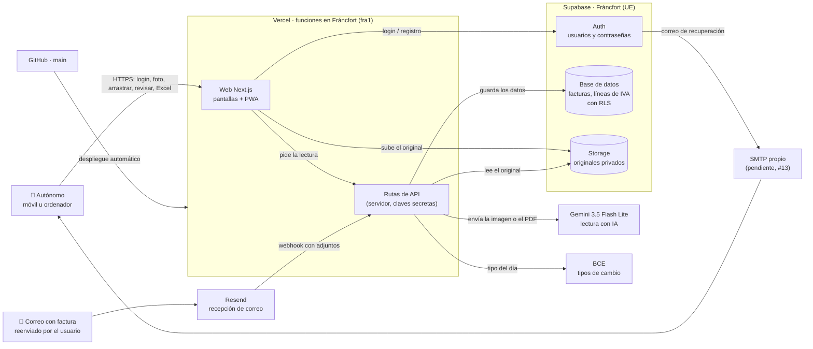

# 05 · Stack y arquitectura

Issue: #5 · Bloque 2 (subida y lectura) · Responsable: Mireia
Depende de: #2 (público objetivo) · Alimenta: #12 (despliegue), #13 (login), #29 (modelo de datos), #18 (originales), #16 (correo), #17 (PWA), #14 (foto), #15 (arrastrar) y #19 (lectura con IA)

> **Estado: stack ACEPTADO para el MVP del curso el 29/10/2026.** Elegido por Mireia entre tres opciones (apartado 4) y aprobado por Javier en la revisión del PR #36. Los puntos del apartado 7 siguen abiertos y se resuelven durante el despliegue (#12) y el login (#13), sin ampliar el alcance. No hay nada instalado ni probado todavía: este documento dice *qué* usaremos y *por qué*, no que ya funcione.

Leyenda:

- **Hecho**: comprobado en una fuente oficial, con fecha de consulta (29/10/2026). Fuentes en el apartado 9.
- **Supuesto**: lo damos por bueno sin haberlo podido comprobar.
- **Recomendación**: propuesta nuestra, que el equipo puede cambiar.

## 1. Decisión (resumen)

| Pieza | Elección | Para qué |
|---|---|---|
| Frontend y backend | **Next.js** (React) | Pantallas de la web y "rutas de API" (el código de servidor que llama a la IA con la clave escondida) en un solo proyecto |
| Hosting | **Vercel**, plan Hobby, funciones en **`fra1` (Fráncfort)** | Publica la web con HTTPS y la despliega sola cada vez que se une un PR a `main` |
| Usuarios y contraseñas | **Supabase Auth** | Registro, login y recuperación de contraseña por correo |
| Base de datos | **Supabase** (PostgreSQL), región **Fráncfort (`eu-central-1`)** | Facturas, líneas de IVA, categorías…; cada usuario ve solo sus filas (RLS) |
| Almacenamiento de originales | **Supabase Storage**, *bucket* privado, misma región | Foto o PDF original, en una carpeta por usuario |
| Correo entrante (#16) | **Resend** (recepción) | Dirección `facturas-<código>@<id>.resend.app` por usuario; avisa a la web con un *webhook* |
| Lectura con IA | **Gemini 3.5 Flash Lite** (decidido en #6) | Extraer los campos de la factura |
| Tipo de cambio | **Tipos de referencia del BCE** | Pasar a euros con el tipo de la fecha de la factura |
| Exportación a Excel | Librería de JavaScript (p. ej. ExcelJS o SheetJS) | Crear el `.xlsx` en la propia web, sin servicio externo |
| Web instalable | **PWA** (manifest de Next.js) | Instalar en la pantalla de inicio y, en Android, aparecer en "Compartir" |

Coste fijo durante el curso: **0 €** con los planes gratis (**Hecho** para los límites del apartado 3). Ninguna de estas cuentas debería pedir tarjeta (ver apartado 3: en dos casos es **supuesto**).

### Glosario

- **Stack**: conjunto de piezas con las que se construye la web.
- **Frontend / backend**: la parte que ve el usuario / la que trabaja por detrás (datos, IA, contraseñas).
- **BaaS**: servicio que trae hecho el backend típico (usuarios, base de datos, archivos). Supabase lo es.
- **Ruta de API**: archivo de Next.js que se ejecuta en el servidor, no en el navegador. Ahí van las claves secretas.
- **RLS** (*Row Level Security*): regla de la base de datos para que cada usuario solo lea y escriba sus filas.
- **Bucket**: "carpeta raíz" de archivos en Supabase Storage. Privado = nadie lo ve sin permiso.
- **Webhook**: aviso automático que un servicio envía a nuestra web ("ha llegado un correo").
- **SMTP**: sistema para *enviar* correos (por ejemplo, el de recuperar contraseña).
- **Variables de entorno**: claves y contraseñas guardadas en Vercel y en el ordenador de cada uno (archivo `.env`, ya excluido en `.gitignore`), nunca en el código de GitHub.

## 2. Por qué (motivo)

1. **Cumple todos los requisitos obligatorios con planes gratis** (tabla del apartado 5).
2. **Sin tarjeta**: es una condición del equipo. Firebase la exige para guardar archivos (apartado 4).
3. **Datos en la UE**: usuarios, facturas y originales se guardan en Fráncfort; las funciones de Vercel también corren allí.
4. **Fácil de construir con IA y de mantener**: Next.js + Supabase es una combinación muy extendida en tutoriales y asistentes (**supuesto** razonable), y Supabase trae ya hechos el login, la recuperación y la separación de datos.
5. **Encaja con el público (#2, autónomos con gestoría)**: móvil primero (PWA y foto desde la web) y coste fijo 0 € mientras se valida, coherente con un precio bajo.

## 3. Planes gratis, tarjeta y región de cada servicio

| Servicio | Límites del plan gratis (**Hecho**) | ¿Pide tarjeta? | Región |
|---|---|---|---|
| Vercel Hobby | 1.000.000 de invocaciones de funciones/mes, 100 GB de transferencia, 4 h de CPU activa, funciones de hasta 300 s, 100 despliegues/día. **Solo uso personal y no comercial** | No (la tarjeta se pide al pasar a Pro) — **Hecho indirecto** | Funciones en **una** región, a elegir: `fra1` — **Hecho** |
| Supabase Free | BD de 500 MB, 1 GB de archivos, 50.000 usuarios activos/mes, 5 GB de transferencia, 2 proyectos. **Se pausa tras 1 semana sin uso**. Archivos de hasta 50 MB (fuente secundaria) | **Supuesto: no** (la web no lo dice por escrito; se entra con GitHub). Confirmarlo al crear la cuenta | Fráncfort `eu-central-1` (también Irlanda, París, Estocolmo) — **Hecho** |
| Resend Free | 3.000 correos/mes y 100/día, **contando enviados y recibidos** | **No indicado**: confirmar al crear la cuenta | **No indicado** para la recepción. **Supuesto**: fuera de la UE |
| Gemini API (plan gratis) | Límites por minuto y por día, visibles en AI Studio | No | No garantizado en la UE |

Si al crear la cuenta de Supabase o Resend apareciera la petición de tarjeta, **parar y avisar al equipo**: el plan B es la opción C del apartado 4.

## 4. Alternativas descartadas

| Opción | Qué era | Por qué se descarta |
|---|---|---|
| **B · Firebase** (Hosting, Auth, Firestore, Storage, Functions) | Todo dentro de Google, igual que Gemini | Cloud Storage for Firebase **exige el plan Blaze** (*"a requirement to use Cloud Storage for Firebase"*) y las Cloud Functions no están en el plan gratis Spark — **Hecho**. Blaze necesita medio de pago. Sin eso no se pueden guardar los originales (#18) |
| **C · Appwrite Cloud** (usuarios, BD, archivos, funciones y hosting en Fráncfort) | Todo en uno y en la UE | No descartada del todo: es el **plan B**. Contras: no se ha podido confirmar si el plan gratis pide tarjeta (la fuente secundaria se contradice), hay menos tutoriales y su base de datos no es SQL clásico, lo que complica la exportación por periodos y los duplicados (**supuesto**) |
| **Netlify** como hosting en lugar de Vercel | Plan gratis que permite uso comercial | Cambiar la región de las funciones a la UE solo está en Pro/Enterprise — **Hecho**. En gratis correrían en Ohio (EE. UU.) |
| **Postmark** para el correo entrante | Servicio veterano de correo | En el plan gratis **no incluye** la recepción de correos (solo Pro y Platform) — **Hecho** |
| **Vertex AI "express mode"** para la IA | Vertex sin tarjeta durante 90 días | Sus condiciones **prohíben tratar datos personales** — **Hecho**. Una factura lleva NIF y nombres |

## 5. Cómo cubre cada requisito

| Requisito | Cómo se hará | Issue |
|---|---|---|
| Usuario y contraseña, recuperación | Supabase Auth con correo y contraseña. Para enviar el correo de recuperación hace falta un SMTP propio (ver apartado 7) | #13 |
| Cada usuario ve solo lo suyo | Políticas RLS en todas las tablas y en el *bucket* (`user_id = auth.uid()`). Criterio de aceptación de #13: probarlo con dos cuentas | #13 |
| Foto desde el móvil | Botón con `<input type="file" accept="image/*" capture="environment">`, que abre la cámara. Vercel da HTTPS por defecto | #14 |
| Arrastrar PDF o imagen | Zona de arrastre en el ordenador; acepta PDF, JPG, PNG y HEIC (**supuesto** de formatos, a fijar en #15) | #15 |
| Reenvío por correo | Resend recibe en `facturas-<código>@<id>.resend.app`, avisa por *webhook* a `/api/correo-entrante`, comprobamos que el remitente es uno de los correos autorizados del usuario y cada adjunto entra como factura | #16 |
| Original enlazado a sus datos | El archivo va directo del navegador al *bucket* privado `originales/<user_id>/…`; la fila de la factura guarda su ruta. Se ve con un enlace temporal firmado | #18 |
| Lectura automática | Una ruta de API de Next.js descarga el archivo del *bucket*, lo envía a Gemini con la instrucción de `docs/prueba-ia.md` (apartado 10) y guarda el JSON. La clave de Gemini solo está en el servidor | #19 |
| Varios tipos de IVA | Tabla `lineas_iva` (varias por factura). Se detalla en #29 | #29 |
| Moneda extranjera | Guardar moneda original, tipo del BCE de la fecha e importe en euros | #20 |
| Duplicados | Huella SHA-256 del archivo + comparación de NIF del emisor, número y total | #22 |
| Exportar a Excel | Librería JavaScript que genera el `.xlsx` del periodo elegido | #23 |
| Página de precios | Página de Next.js | #24 |
| PWA y Compartir | Manifest con `share_target`. **Hecho**: funciona en Chrome Android, Samsung Internet y Chrome de escritorio; **no en Safari de iPhone ni en Firefox**. En iPhone la vía rápida es el reenvío por correo | #17 |

## 6. Diagrama de arquitectura

Cómo leerlo: el usuario solo habla con la web. La web guarda el original directamente en Supabase y pide a las rutas de API que lo lean. Las rutas de API son las únicas que conocen las claves de Gemini y de Supabase con permisos de servidor. El correo reenviado entra por Resend y sigue el mismo camino que una subida normal.

## 7. Pendiente de confirmar

| # | Qué | Quién (propuesta) | Cómo se da por cerrado |
|---|---|---|---|
| 1 | **Validar esta propuesta** | Anaí y Javier | ✅ Aprobada por Javier el 29/10/2026 (PR #36) |
| 2 | Que **Supabase** y **Resend** no pidan tarjeta al crear la cuenta. No se da por confirmado hasta crearlas | Javier (#12) y Mireia (#16) | Cuenta creada sin tarjeta; si la piden, parar y pasar al plan B |
| 3 | Correo de recuperación. **Acordado:** en local, **Mailpit** (programa que "atrapa" los correos de prueba en el ordenador, sin enviarlos de verdad); en la demo desplegada, un **SMTP personalizado**. Gmail con "contraseña de aplicación" es solo una alternativa temporal, **no decidida** hasta probarla. **Supuesto**: Resend solo envía a cualquier destinatario con un dominio propio verificado | Javier (#13) | En local, el correo aparece en Mailpit; en la demo, llega el correo de recuperación a una dirección externa al equipo |
| 4 | **IA en el curso:** Gemini API gratis, **solo para pruebas académicas con documentos ficticios o anonimizados**, sin usuarios externos. Las condiciones de Google dicen que para ofrecer la web a usuarios del EEE hay que usar servicios de pago — **Hecho**. Antes de abrirla a usuarios externos del EEE, revisar las condiciones aplicables y la modalidad necesaria | Equipo | ✅ Acordado en la revisión del PR #36 |
| 5 | **IA en un lanzamiento real:** Vertex AI en el endpoint `eu`. **Hecho**: exige cuenta de facturación con tarjeta u otro medio de pago. Además, **sin confirmar** que `gemini-3.5-flash-lite` esté disponible en `eu`. Decisión del equipo, fuera del alcance del curso | Equipo | Fuera del MVP |
| 6 | **Uso comercial:** Vercel Hobby es para uso personal y no comercial. **Acordado:** se mantiene para la demo académica; si se comercializa Ticketon, revisar el alojamiento (p. ej. Vercel Pro, 20 $/mes por persona, u otro hosting) | Equipo / #3 (modelo de negocio) | ✅ Acordado en la revisión del PR #36; anotar en el modelo de negocio |
| 7 | **Dónde procesa Resend los correos** (no consta). Afecta a la normativa | Javier (#4, legal) | Respuesta documentada en el doc legal |
| 8 | **Límite de tamaño** de las peticiones a las funciones de Vercel. **Supuesto**: es bajo (unos pocos MB), por eso el original se sube directo a Supabase y no pasa por la función | Mireia (#18) | Probado con una foto de móvil de más de 5 MB |
| 9 | **Pausa de Supabase** tras 1 semana sin uso: acordarse de entrar antes de la presentación | Equipo | — |
| 10 | **API del BCE**: comprobar que es pública y sin registro, y qué hacer en fines de semana y festivos (no hay tipo publicado) | Anaí (#20, moneda) | Conversión probada con una factura en dólares |

### Si cambiara el público objetivo (#2)

- **Gestorías** (ven los gastos de muchos autónomos): el stack sirve igual; cambian el modelo de datos (#29, "organizaciones" y permisos) y las políticas RLS. El 1 GB gratis de archivos se quedaría corto antes.
- **Pymes con empleados**: mismo stack, más trabajo de equipos y aprobaciones.

## 8. Qué queda fuera de este documento

- El detalle de tablas y campos: **#29** (modelo de datos).
- La estructura de carpetas del proyecto y las variables de entorno: **#12** (despliegue).
- La normativa (RGPD, conservación de facturas): **#4**. Nada de este documento es asesoramiento legal.

## 9. Fuentes (consultadas el 29/10/2026)

Hosting
- Vercel · Plan Hobby: https://vercel.com/docs/plans/hobby
- Vercel · Regiones de las funciones: https://vercel.com/docs/functions/configuring-functions/region
- Netlify · Configuración de funciones (región solo en Pro/Enterprise): https://docs.netlify.com/build/functions/optional-configuration/

Supabase
- Precios: https://supabase.com/pricing
- Regiones: https://supabase.com/docs/guides/platform/regions
- SMTP propio (el de serie: solo equipo y 2 correos/hora): https://supabase.com/docs/guides/auth/auth-smtp
- Secundaria · Costbench (archivos de hasta 50 MB, revisado 24/07/2026): https://costbench.com/software/database-as-service/supabase/free-plan/

Alternativas
- Firebase · Precios: https://firebase.google.com/pricing
- Firebase · Cloud Storage exige Blaze: https://firebase.google.com/docs/storage/web/start
- Appwrite · Plan gratis: https://appwrite.io/docs/advanced/platform/free
- Appwrite · Regiones: https://appwrite.io/docs/products/network/regions
- Secundaria · freetier.co, Appwrite (18/08/2026): https://freetier.co/directory/products/appwrite
- Postmark · Precios: https://postmarkapp.com/pricing

Correo entrante
- Resend · Recibir correos: https://resend.com/docs/dashboard/receiving/introduction
- Resend · Cuotas (los recibidos cuentan): https://www.resend.com/docs/knowledge-base/account-quotas-and-limits.md
- Resend · Precios: https://resend.com/pricing

IA
- Google · Condiciones de la API de Gemini: https://ai.google.dev/gemini-api/terms
- Google · Facturación de la API de Gemini: https://ai.google.dev/gemini-api/docs/billing
- Google Cloud · Prueba gratuita y medio de pago: https://docs.cloud.google.com/free/docs/free-cloud-features
- Google Cloud · Express mode (FAQ): https://cloud.google.com/resources/cloud-express-faqs
- Google Cloud · Condiciones de express mode: https://cloud.google.com/terms/google-cloud-express
- Google Cloud · Residencia de datos en Vertex AI: https://docs.cloud.google.com/vertex-ai/generative-ai/docs/learn/data-residency

Móvil y moneda
- caniuse · `share_target`: https://caniuse.com/mdn-manifests_webapp_share_target
- BCE · Tipos de referencia del euro: https://www.ecb.europa.eu/stats/policy_and_exchange_rates/euro_reference_exchange_rates/html/index.en.html
