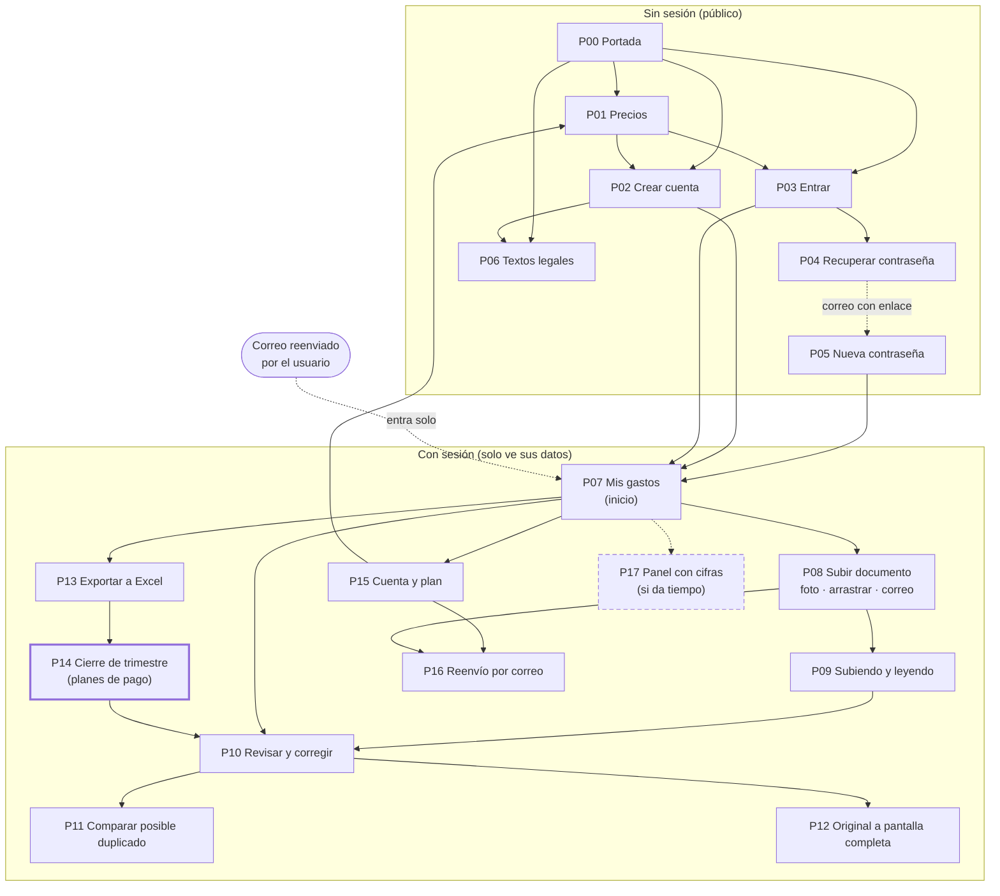
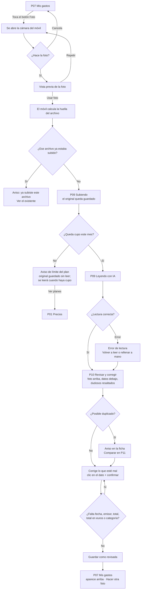
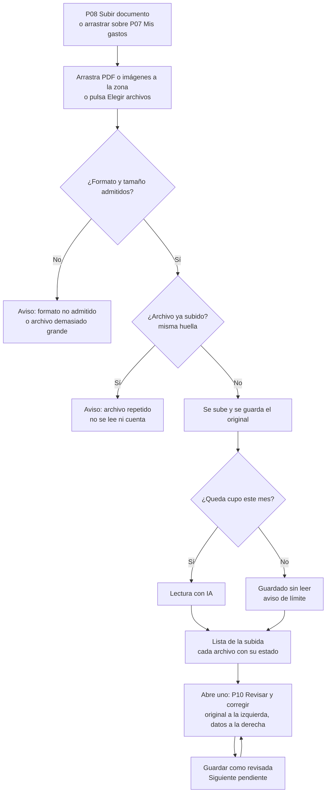
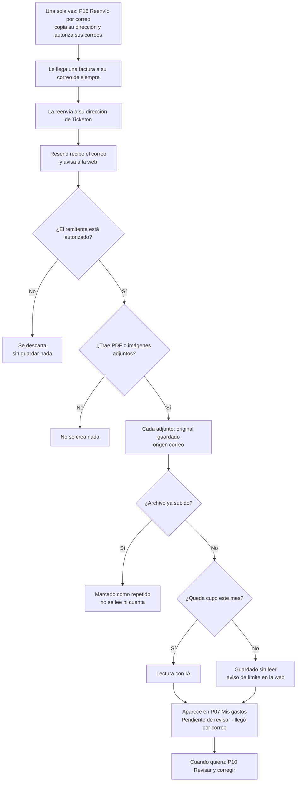
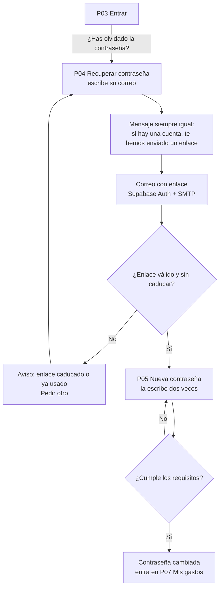
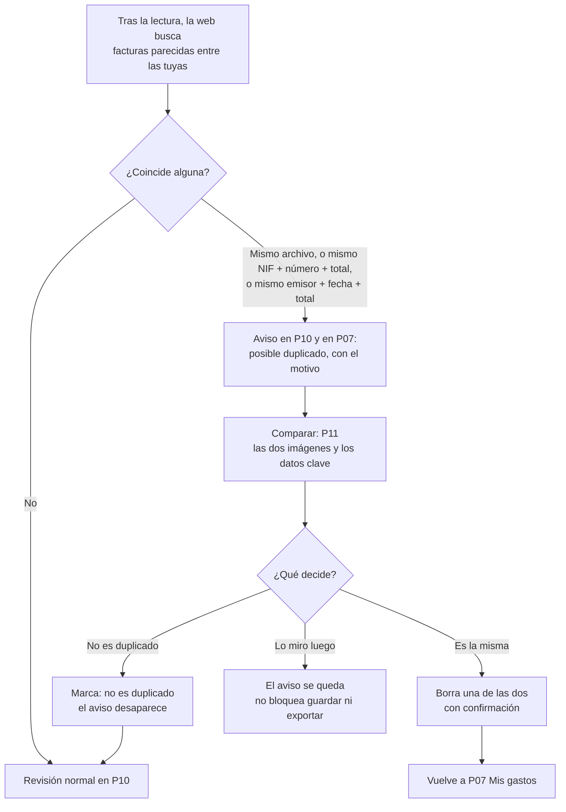
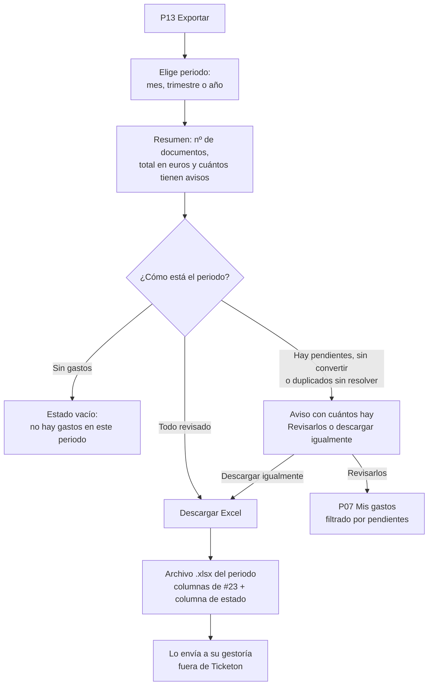
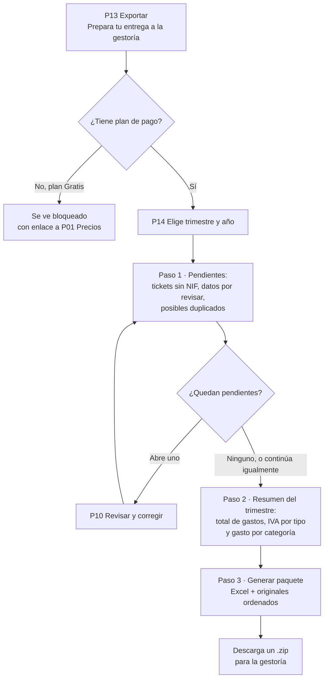

# 10 · Mapa de pantallas y flujos de usuario

Tarea: #8 (orden 10) · Bloque 2 (subida y lectura) · Responsable: Mireia · Última actualización: 29/10/2026
Depende de: #2 (público objetivo) y #7 (funciones adicionales). Usa también #5 (arquitectura), #29 (modelo de datos), #3 (modelo de negocio) y #4 (normativa) · Alimenta: #9 (requisitos de diseño) y #11 (prototipo)

**Estado:** **[Propuesta]**. Las nueve decisiones del apartado 6 las tomó Mireia el 29/10/2026, eligiendo la opción recomendada en todas. Pendiente de la revisión de Ana y Javier. No hay ninguna pantalla construida: este documento dice *qué pantallas habrá y cómo se pasa de una a otra*, no cómo se ven ni que funcionen.

Etiquetas (según la [guía de estilo](guia-estilo.md)):

- **[Confirmado]**: comprobado en el enunciado o en un documento o issue del repositorio (consultados el 29/10/2026).
- **[Supuesto]**: lo damos por bueno para avanzar; se indica qué hay que comprobar.
- **[Propuesta]**: decisión o recomendación del equipo; se puede cambiar.
- **[Pendiente]**: falta información o una decisión para poder cerrarlo.

## Glosario

- **Mapa de pantallas**: la lista de todas las pantallas de la web y las flechas que dicen desde cuál se puede ir a cuál. Es como el plano de una casa: qué habitaciones hay y qué puertas las unen, sin decir todavía de qué color son las paredes.
- **Flujo de usuario**: el camino paso a paso que sigue una persona para conseguir algo concreto (por ejemplo, "subir un ticket con el móvil"), incluidos los desvíos cuando algo sale mal.
- **Estado**: lo que muestra una pantalla en una situación concreta: cargando, vacía, con error, con un aviso…
- **Rombo** (en los diagramas): una pregunta o comprobación con varias salidas ("¿Queda cupo este mes?").
- **Huella del archivo**: código que se calcula a partir del archivo; el mismo archivo da siempre la misma huella (ver [modelo de datos](modelo-datos.md)).
- **Cupo**: los documentos que el plan deja leer con IA cada mes (10, 100 o 300).
- **PWA**: web que se puede instalar en la pantalla de inicio del móvil como si fuera una app.

## 1. Para qué sirve este documento

1. **Antes de dibujar, ponerse de acuerdo en qué hay que dibujar.** Javier (#9) necesita saber qué pantallas llevan requisitos de diseño, y los tres (#11), qué pantallas tiene el prototipo y en qué orden se recorren.
2. **Comprobar que no falta nada obligatorio.** Si un requisito del enunciado no tiene pantalla, no se va a construir. El apartado 7 lo comprueba.
3. **Ver los casos difíciles antes de programar.** Qué pasa si la IA falla, si el ticket ya estaba subido o si se acaba el cupo. Es más barato decidirlo aquí que rehacer pantallas.
4. **Que el diseño, el prototipo y la web digan lo mismo.** Cada pantalla tiene un código (P00, P01…) que se usará en #9, #11 y en los issues de la fase 4.

Qué **no** decide este documento: colores, tipografía, tamaño de los botones ni textos definitivos (#9), ni cómo se programa cada pantalla (fase 4).

## 2. Resumen

- **18 pantallas**: 7 públicas (sin sesión) y 11 privadas (con sesión). De ellas, **14 cubren requisitos obligatorios**, 2 vienen del plan del equipo (Portada y Textos legales, #25), 1 es **extra de pago** (Cierre de trimestre, #50) y 1 es **"si da tiempo"** (Panel, #26).
- **11 estados** que se repiten en varias pantallas (apartado 4).
- **8 diagramas**: el mapa general y 7 flujos (apartado 5).
- **9 decisiones** tomadas y **8 decisiones menores** asumidas (apartado 6).

## 3. Lista de pantallas

Planes según el [modelo de negocio](modelo-negocio.md) (precios **[Supuesto]** provisionales): **Gratis** (10 documentos/mes), **Autónomo** (4,99 €, 100) y **Autónomo Plus** (8,99 €, 300). Funciones por plan según [funciones adicionales](funciones.md), apartado 5 **[Confirmado]**: todo lo obligatorio, la instalación en el móvil y los avisos están en los tres planes; el Cierre de trimestre, solo en los de pago; el plan del Panel está **[Pendiente]**.

Tipo: **Obligatoria** (sale del enunciado), **Plan del equipo** (no lo pide el enunciado, pero está en un issue), **Extra** (función adicional elegida en #7), **Si da tiempo**.

### 3.1 Navegación general **[Propuesta]**

- **Móvil** (lo principal, [público objetivo](publico-objetivo.md): "subir un ticket en pocos toques"): barra fija abajo con cuatro botones: **Gastos** (P07) · **Foto** (abre la cámara) · **Exportar** (P13) · **Cuenta** (P15). El botón Foto va en el centro y destacado.
- **Ordenador**: el mismo menú en una columna a la izquierda, con **Subir** (P08) en lugar de Foto.
- Arriba, siempre visible: el contador del mes ("7 de 10 documentos este mes") (#31).

### 3.2 Públicas (sin sesión)

| Código | Pantalla | Qué muestra | Qué puede hacer el usuario | Sale de | Tipo | Plan |
|---|---|---|---|---|---|---|
| P00 | **Portada** | La propuesta de valor ([público objetivo](publico-objetivo.md), apartado 4) y enlaces a Precios, Entrar y Crear cuenta | Ir a Precios, Entrar o Crear cuenta | #25 | Plan del equipo | Pública |
| P01 | **Precios** | Los tres planes: precio al mes, documentos al mes y qué incluye cada uno. El Cierre de trimestre se muestra como la diferencia de los planes de pago (#7) | Comparar planes; empezar gratis; elegir un plan de pago. **[Pendiente]** Qué pasa al elegir un plan de pago: el sistema de cobro se decide solo cuando se implementen pagos (`modelo-negocio.md`, apartado 5) | Enunciado (página de precios) · #24 | Obligatoria | Pública |
| P02 | **Crear cuenta** | Correo y contraseña (dos veces) y enlaces a la privacidad y las condiciones de uso | Registrarse; ir a Entrar. **[Pendiente #4]** Cómo se informa y si hay que aceptar algo: `legal.md` pide no usar el consentimiento como solución automática | Requisito 1 · #13 | Obligatoria | Todos (empieza en Gratis, `modelo-datos.md` 3.1) |
| P03 | **Entrar** | Correo y contraseña | Entrar; "¿Has olvidado la contraseña?"; ir a Crear cuenta | Requisito 1 · #13 | Obligatoria | Todos |
| P04 | **Recuperar contraseña** | Campo de correo | Pedir el enlace. Siempre ve el mismo mensaje, exista o no la cuenta, para no revelar qué correos están dados de alta **[Propuesta]** | Requisito 1 · #13 | Obligatoria | Todos |
| P05 | **Nueva contraseña** | Se abre desde el enlace del correo. Nueva contraseña dos veces | Guardarla y entrar. Requisitos de la contraseña: **[Pendiente #13]** | Requisito 1 · #13 | Obligatoria | Todos |
| P06 | **Textos legales** | Política de privacidad, aviso legal y cookies (#25); condiciones de uso (`legal.md`, apartado 7.1) | Leerlos | #25 · #4 | Plan del equipo | Pública |

### 3.3 Privadas (con sesión)

Cada usuario ve **solo sus datos** en todas estas pantallas (RLS, [modelo de datos](modelo-datos.md), apartado 5).

| Código | Pantalla | Qué muestra | Qué puede hacer el usuario | Sale de | Tipo | Plan |
|---|---|---|---|---|---|---|
| P07 | **Mis gastos** (inicio tras entrar, DP1) | Lista de documentos, el más nuevo arriba: fecha, emisor, total en €, categoría y estado (**pendiente de revisar** / **revisada**). Etiquetas de aviso (posible duplicado, sin NIF, sin convertir, llegó por correo) y franja arriba si hay avisos (DP9) | Abrir uno (P10); subir (Foto o P08); en el ordenador, arrastrar archivos encima. **Mejora, después del listado básico (#30):** filtros por periodo, categoría, emisor, estado y "con avisos", y búsqueda por texto | #30 · #27 | Obligatoria (es donde se abre cada factura con su original: requisitos 4 y 6, según #30) | Todos |
| P08 | **Subir documento** | Las tres vías juntas: botón **Hacer foto** (en el móvil abre la cámara), **zona para arrastrar** PDF o imágenes y botón Elegir archivos, y la **dirección de reenvío** con botón Copiar | Hacer foto; arrastrar o elegir uno o varios archivos **[Propuesta]**; copiar la dirección; ir a P16 | Requisito 2 · #14, #15, #16 | Obligatoria | Todos |
| P09 | **Subiendo y leyendo** | Progreso de cada archivo: subiendo → original guardado → leyendo con IA → listo. Si son varios, una lista con el estado de cada uno | Esperar; cancelar la subida. Al terminar la lectura pasa sola a P10 (DP3) | #18, #19 | Obligatoria | Todos |
| P10 | **Revisar y corregir** | **El original junto a los datos**: en el móvil, foto arriba (se amplía con un toque) y datos debajo (DP4); en el ordenador, original a la izquierda con zoom y datos a la derecha (#21). Datos: tipo (ticket/factura), fecha, emisor, NIF del emisor, NIF del receptor, número, líneas de IVA (tipo, base, cuota; varias), retención si la hay, total, moneda, tipo de cambio y total en €, categoría. **Resaltados** los datos vacíos o de confianza baja (#21). Avisos de la ficha: posible duplicado, ticket sin NIF, las cuentas no cuadran, falta convertir | Corregir cualquier dato con **clic en el campo + confirmar** (apartado 3.4); añadir o quitar una línea de IVA; cambiar el tipo de cambio a mano; **Guardar como revisada**; volver a leer con IA; ver el original en grande (P12); comparar duplicado (P11); borrar el documento (con confirmación) | Requisitos 3, 4, 5 y 6 · #21, #20, #22, #18 | Obligatoria | Todos |
| P11 | **Comparar posible duplicado** | Las dos imágenes (una sobre otra en el móvil, lado a lado en el ordenador), los datos clave de cada una y el motivo del aviso ("mismo archivo", "mismo NIF, número y total" o "mismo emisor, fecha y total") | Borrar una de las dos; marcar "no es duplicado"; volver sin decidir | Requisito 5 · #22 | Obligatoria | Todos |
| P12 | **Original a pantalla completa** | La foto o el PDF original, con zoom | Ampliar, descargar el original, volver | Requisito 6 · #18 | Obligatoria | Todos |
| P13 | **Exportar** | Elegir periodo: mes, trimestre o año (#23). Resumen: número de documentos, total en € y cuántos tienen avisos. Acceso al Cierre de trimestre | Descargar el Excel del periodo; revisar los pendientes; abrir el Cierre de trimestre | Requisito 7 · #23 | Obligatoria | Todos |
| P14 | **Cierre de trimestre** ("Prepara tu entrega a la gestoría") | Tres pasos (#50): 1) pendientes del trimestre: tickets sin NIF, datos por revisar y posibles duplicados; 2) resumen: total de gastos, IVA por tipo y gasto por categoría; 3) paquete .zip con el Excel del periodo y los originales ordenados | Resolver pendientes (abre P10); continuar; descargar el paquete. Ningún texto promete nada fiscal (#50) | #50 · #7 | Extra | Autónomo y Autónomo Plus. En Gratis se ve bloqueado (DP7) |
| P15 | **Cuenta y plan** | Nombre y NIF propio (sirve para avisar si una factura va a nombre de otro); plan actual y documentos usados este mes; enlace a Reenvío por correo; instalar en el móvil; cerrar sesión | Cambiar nombre y NIF; ver o cambiar de plan (lleva a P01); cerrar sesión. **[Pendiente #4]** Darse de baja y borrar la cuenta | #13, #31, #17 | Obligatoria (sesión y plan) | Todos |
| P16 | **Reenvío por correo** | La dirección propia (`facturas-<código>@…`) con botón Copiar; la lista de **correos autorizados** (desde los que reenvía); instrucciones cortas para reenviar desde Gmail y Outlook, y aviso de que los correos de otras direcciones se descartan (DP5) | Copiar la dirección; añadir o quitar correos autorizados | Requisito 2 · #16 | Obligatoria | Todos |
| P17 | **Panel con cifras** | Documentos y gasto del mes, gasto por categoría, comparación con el mes pasado (enunciado, funciones adicionales) | Mirar; ir a la lista filtrada | #26 · #7 | **Si da tiempo** | **[Pendiente]** (`funciones.md`, apartado 5) |

### 3.4 Qué significa "corregir en dos clics" **[Propuesta]**

Criterio de aceptación para #9, #11 y #21, desde P10 abierta. #21 lo define como "clic en el campo + guardar" **[Confirmado]**:

1. **Clic 1:** sobre el dato equivocado. Se vuelve editable y aparece el teclado adecuado (números para importes, calendario para la fecha, lista para la categoría).
2. **Clic 2:** confirmar (tecla Intro o botón "Listo" junto al campo). Se guarda en ese momento; no hace falta un botón "Editar" antes ni un "Guardar cambios" al final de la ficha.

No cuenta como "dos clics" tener que abrir otra pantalla o un formulario aparte. Escribir el valor no cuenta como clic. **"Guardar como revisada"** es un paso aparte: confirma que *toda* la ficha está bien, no cada dato.

### 3.5 Elementos que no son pantallas

| Elemento | Dónde aparece | Sale de | Tipo |
|---|---|---|---|
| **Avisos dentro de la web** (no por correo): posible duplicado, ticket sin NIF del receptor y trimestre a punto de cerrar | En la ficha (P10), como etiqueta y filtro en P07 y como franja arriba en P07 (DP9) | Requisito 5 · #22 · #27 · #7 | Duplicado: obligatorio. Los otros dos: extra, en todos los planes |
| **Instalar en el móvil (PWA)** | Botón en P15 y franja la primera vez que entra desde el móvil **[Propuesta]** | #17 · #7 | Extra, todos los planes |
| **Compartir desde el móvil** | Al elegir "Compartir" en un PDF, Ticketon aparece en la lista y lleva a P09. **[Confirmado]** Funciona en Chrome para Android, Samsung Internet y Chrome de escritorio, no en Safari de iPhone ni en Firefox ([funciones](funciones.md)) | #17 · #7 | Extra, incluido en la instalación en el móvil |
| **Avisos del límite del plan** | P09, P07 y P15, con enlace a Precios | #31 | Obligatoria (el plan Gratis tiene límite) |

**[Pendiente #27]** Cuántos días antes del fin de trimestre sale el aviso "trimestre a punto de cerrar".

## 4. Estados importantes

| Código | Estado | Dónde | Qué ve el usuario | Qué puede hacer | Sale de |
|---|---|---|---|---|---|
| E1 | **Cargando / subiendo** | P07, P09, P13 | Barra de progreso por archivo | Esperar; cancelar la subida | #18 |
| E2 | **Leyendo con IA** | P09 | "Leyendo tu ticket…". **[Supuesto]** Tarda unos segundos; medirlo en #19 | Esperar; al terminar pasa sola a P10 | #19, DP3 |
| E3 | **Error de lectura** | P09, P10 | "No hemos podido leer este documento. El original está guardado." | Volver a leer (no gasta cupo, D4) o rellenar los datos a mano en P10 | #19, `modelo-datos.md` D4 y D7 |
| E4 | **Archivo repetido** (misma huella, antes de leer) | P09 | "Ya subiste este archivo el dd/mm." No se lee ni cuenta para el cupo | Ver el que ya está. **[Pendiente #22]** Si se deja subirlo igualmente | #22, D1 y D4 |
| E5 | **Posible duplicado** (después de leer) | P10, P07 | Franja de aviso con el motivo | Comparar (P11); "no es duplicado"; dejarlo para luego. **Nunca bloquea** | Requisito 5 · #22, D1 |
| E6 | **Límite del plan alcanzado** | P09, P07, P15 | "Has usado tus 10 documentos de este mes." El original **sí** se guarda, sin leer, y se lee cuando vuelva a haber cupo (DP8) | Ver planes (P01) | #31, D4 |
| E7 | **Sin documentos todavía** | P07 | Explicación de una línea y las tres vías: botón Foto, zona de arrastre y la dirección de reenvío | Subir el primero | #8 |
| E8 | **Formato o tamaño no admitido** | P08, P09 | "Este archivo no se puede subir: solo PDF, JPG, PNG o HEIC." **[Supuesto]** de formatos y tamaño máximo, a fijar en #15 | Elegir otro | #15 |
| E9 | **Periodo sin gastos** | P13, P14 | "No hay gastos en este periodo" | Cambiar de periodo | #23 |
| E10 | **Falta convertir a euros** | P10, P07, P13 | "Factura en USD: falta el tipo de cambio." No se puede marcar como revisada hasta convertirla | Esperar al tipo del BCE o escribirlo a mano | #20, `modelo-datos.md` 3.6 |
| E11 | **Enlace de recuperación caducado o ya usado** | P05 | "Este enlace ya no sirve" | Pedir otro (P04) | #13 |

## 5. Flujos de usuario

Cómo leer los diagramas: los rectángulos son pasos o pantallas (con su código), los rombos son preguntas y las flechas llevan el texto de lo que hace el usuario o de la respuesta. Las líneas discontinuas son cosas que pasan sin que el usuario esté en la web (un correo) o funciones "si da tiempo".

### 5.0 Mapa general

### 5.1 Flujo principal en móvil: foto → datos → corregir → guardar

Es el flujo del issue #8 y el más importante ([público objetivo](publico-objetivo.md): "si subir un ticket le cuesta más de unos segundos, deja de hacerlo"). El camino sin errores son **unos cuatro toques** (Foto → disparar → Usar foto → Guardar como revisada), más los de corregir; el número exacto depende de la cámara de cada móvil **[Supuesto]**.

Notas:

- **[Confirmado]** #14 pide vista previa y opción de repetir la foto.
- **[Confirmado]** El original se guarda **antes** de leer: si la IA falla, no se pierde el ticket (`modelo-datos.md`, D7).
- **[Confirmado]** Para marcarla como revisada son obligatorios fecha, emisor, total, total en euros y categoría (`modelo-datos.md`, 3.6). Si la IA no los leyó, P10 los resalta.
- **[Supuesto]** La huella se calcula en el móvil antes de subir (D1); comprobarlo en #22.
- Si el usuario no quiere revisar en ese momento, puede salir: la ficha queda como **pendiente de revisar** en P07.

### 5.2 Subida desde el ordenador

Notas: **[Propuesta]** se pueden soltar varios archivos a la vez, igual que un correo puede traer varios adjuntos ([arquitectura](arquitectura.md)). El botón "Siguiente pendiente" ahorra volver a la lista en cada uno. Si el cupo se acaba a mitad de una subida, los archivos que no caben se guardan sin leer (DP8).

### 5.3 Reenvío por correo

Es la tercera vía obligatoria del requisito 2 (#16, [funciones](funciones.md)). **[Confirmado]** El enunciado dice que si subir un PDF obliga a descargarlo, buscarlo en una carpeta y subirlo, no cumple: con el reenvío, el usuario no descarga nada.

Notas:

- **[Confirmado]** Solo se aceptan adjuntos de los correos autorizados del usuario; los demás se ignoran (#16, `modelo-datos.md` 3.4). Así no se guardan datos de quien no es el usuario ni se gasta cupo con correo basura (DP5).
- **[Confirmado]** El plan gratis de Resend cuenta los correos recibidos: 100 al día y 3.000 al mes para toda la web ([arquitectura](arquitectura.md), apartado 3). Basta para la demo; no para muchos usuarios.
- Fuera del MVP **[Propuesta]**: facturas que vienen como enlace de descarga o en el cuerpo del correo, sin adjunto.
- Los avisos son **dentro de la web, no por correo** (#7). El usuario se entera al entrar en P07.

### 5.4 Recuperación de contraseña

Notas: **[Confirmado]** El correo de recuperación necesita un SMTP propio; en local se prueba con Mailpit ([arquitectura](arquitectura.md), apartado 7, punto 3). **[Supuesto]** Que tras cambiar la contraseña el usuario entra directamente, sin volver a escribirla; comprobarlo en #13.

### 5.5 Corrección de un duplicado

Notas: **[Confirmado]** Las tres reglas y "solo aviso, nunca bloquea" son la decisión D1 del [modelo de datos](modelo-datos.md); #22 pide además la opción de ver la otra factura. **[Confirmado]** Borrar un documento no devuelve el hueco del cupo (D4): P11 debe decirlo antes de confirmar. El caso "mismo archivo" se detecta normalmente **antes** de leer (estado E4); este flujo es sobre todo para el mismo ticket fotografiado dos veces o la foto y el PDF de la misma factura.

### 5.6 Exportación a Excel

Notas: **[Confirmado]** Las columnas del Excel y cómo se enlaza el original son decisiones **bloqueantes de #23** (`modelo-datos.md`, 8.2, puntos 5 y 6); este mapa no las decide, salvo pedir una columna de estado (DP6). **[Propuesta]** El periodo por defecto es el trimestre en curso. Ticketon no envía nada a la gestoría: el usuario descarga el archivo.

### 5.7 Cierre de trimestre

Función adicional de los planes de pago (#50, [funciones](funciones.md)).

Notas: **[Confirmado]** El plan Gratis mantiene la exportación a Excel normal (P13) (#50). Se puede continuar con pendientes, igual que en la exportación (DP6). **[Pendiente]** Que generar un .zip con muchos originales funcione dentro de los límites de las funciones de Vercel ([arquitectura](arquitectura.md), apartado 3); comprobarlo al construir #50.

## 6. Decisiones

### 6.1 Decisiones tomadas **[Propuesta]**

Decididas por Mireia el 29/10/2026: la opción A en las nueve. Se dejan las alternativas para que la revisión pueda proponer otra.

| # | Decisión | Opciones | Pros | Contras |
|---|---|---|---|---|
| DP1 | **Primera pantalla tras entrar** | **A (elegida) · Mis gastos** con el botón Foto destacado | Ve lo que tiene y lo que le falta; la foto está a un toque igual | Una pantalla con más cosas que diseñar |
| | | B · Subir documento (P08) | Lo más directo para subir | Para revisar o exportar siempre tiene que salir de ahí |
| | | C · Panel con cifras | Vistoso | Es "si da tiempo": no puede ser la base |
| DP2 | **Qué hace el botón Foto** | **A (elegida) · Abre la cámara directamente** desde la barra de abajo | Un toque menos; es el flujo principal | En el móvil, la zona de arrastre y el correo quedan en P08, un paso más allá |
| | | B · Lleva a P08 y allí se elige foto, archivo o correo | Las tres vías siempre juntas | Un toque más en cada ticket |
| DP3 | **¿Esperar a que la IA lea?** | **A (elegida) · Esperar** en P09 y pasar solo a corregir | Es exactamente el flujo del issue (foto → datos → corregir → guardar); más fácil de construir | Si la IA tarda, espera; con diez tickets seguidos es más lento |
| | | B · No esperar: hacer más fotos y revisar todas después | Rápido para quien acumula tickets | El usuario puede olvidarse de revisar; más difícil de construir |
| | | C · Esperar, con un botón "Hacer otra foto mientras" | Lo mejor de las dos | Más trabajo; mejor dejarlo para después del MVP |
| DP4 | **Corrección en el móvil: cómo se ve la foto junto a los datos** | **A (elegida) · Foto arriba** (pequeña, se amplía con un toque) **y datos debajo** | Cumple "ver la foto junto a los datos"; sencilla | En pantallas pequeñas la foto se ve chica |
| | | B · Dos pestañas: Original / Datos | Foto grande | **No** se ven a la vez: cumple peor el enunciado |
| | | C · Foto a pantalla completa con los datos en una hoja que se desliza desde abajo | Foto grande y datos a mano | Más difícil de diseñar y programar |
| DP5 | **Correo de un remitente no autorizado** | **A (elegida) · Se descarta** sin guardar nada (coincide con #16) | No guarda datos de quien no es el usuario ([normativa](legal.md)) ni gasta cupo con correo basura; lo más simple | Si el usuario reenvía desde otra cuenta, no se entera de por qué no llega. Se mitiga explicándolo en P16 |
| | | B · Se guarda en "correos por autorizar" y el usuario decide | No se pierde nada | Guarda adjuntos de desconocidos; más pantallas y más riesgo |
| DP6 | **Exportar con documentos pendientes** (sin revisar, sin convertir o duplicados sin resolver) | **A (elegida) · Avisar y dejar exportar**; el Excel lleva una columna de estado | No bloquea al usuario el día que le corre prisa; la gestoría ve qué falta | Pueden llegar datos sin revisar a la gestoría |
| | | B · Obligar a revisarlos antes | Datos siempre revisados | Bloquea; las facturas en otra moneda sin tipo de cambio pueden atascarlo |
| | | C · Exportar solo las revisadas | Datos limpios | Se pueden quedar gastos fuera sin darse cuenta |
| DP7 | **Cierre de trimestre en el plan Gratis** | **A (elegida) · Se ve, bloqueado**, con una frase y enlace a Precios (#31 admite "ocultas o bloqueadas") | Enseña la ventaja de pagar | Puede parecer publicidad |
| | | B · No aparece | Pantalla más limpia | El usuario gratis no sabe que existe |
| DP8 | **Al llegar al límite del plan** | **A (elegida) · Se guarda el original sin leer**; se lee cuando vuelva a haber cupo (mes siguiente o plan superior) | No se pierde ningún ticket; protege el modelo de negocio | El usuario gratis espera o paga |
| | | B · Igual que A, y además puede rellenar los datos a mano sin gastar cupo | Nunca se queda bloqueado | Con datos a mano, el plan Gratis deja de tener límite real: afecta a #3 |
| | | C · No deja subir más | Lo más simple | Se pierden tickets: va contra la propuesta de valor |
| DP9 | **Dónde se ven los avisos** | **A (elegida) · En la ficha, como etiqueta y filtro en Mis gastos** y una franja arriba si hay alguno | Sin pantallas nuevas; el aviso está donde se arregla | Con muchos avisos, la lista se llena de etiquetas |
| | | B · Pantalla propia "Avisos" | Todo en un sitio | Una pantalla más que diseñar, construir y probar |

**Aviso:** DP8 A deja una pregunta para #31: cuándo se leen los documentos guardados sin leer al empezar el mes nuevo (todos de golpe, gastando cupo del mes nuevo, o al pulsar "Leer ahora"). **[Pendiente #31]**

### 6.2 Decisiones menores asumidas **[Propuesta]**

Se pueden cambiar en la revisión del PR sin rehacer el mapa:

1. Navegación con barra inferior de cuatro botones en el móvil y columna a la izquierda en el ordenador (3.1).
2. Se pueden subir varios archivos a la vez al arrastrar (5.2).
3. P04 muestra siempre el mismo mensaje, exista o no la cuenta (5.4).
4. El Cierre de trimestre se abre desde Exportar, no desde el menú (3.3).
5. Ver el original en grande (P12) se abre desde P10, no es una sección del menú.
6. Mientras no exista la portada (#25), la entrada pública es Precios.
7. El periodo por defecto al exportar es el trimestre en curso.
8. Ajustes del correo (P16) accesibles desde Subir y desde Cuenta.

## 7. Comprobación: requisito obligatorio → pantalla

| Requisito obligatorio (enunciado) | Pantallas | Flujo | Issue | Cubierto |
|---|---|---|---|---|
| 1. Usuario y contraseña; cada usuario ve solo lo suyo; recuperar la contraseña | P02, P03, P04, P05; todas las privadas filtran por usuario | 5.4 | #13 | **Sí** (en el mapa) |
| 2a. Foto con el móvil desde la web | Botón Foto (barra), P08, P09 | 5.1 | #14 | **Sí** |
| 2b. Arrastrar un PDF o una imagen desde el ordenador | P08 y P07 (zona de arrastre), P09 | 5.2 | #15 | **Sí** |
| 2c. Vía rápida para un PDF recibido por correo | P16, P08 (dirección), P07 | 5.3 | #16 | **Sí** |
| 3. Lectura automática de los datos (incluida moneda y conversión) | P09, P10 (campos), E10 | 5.1, 5.2, 5.3 | #19, #20 | **Sí** |
| 4. Ver la foto junto a los datos y corregir en dos clics | P10 (DP4 A), criterio del apartado 3.4 | 5.1 | #21 | **Sí** |
| 5. Aviso de duplicados | E4, E5, P10, P11, P07 | 5.5 | #22 | **Sí** |
| 6. Original siempre guardado y enlazado a sus datos | P09 (se guarda antes de leer), P10, P12, E3, E6 | 5.1, 5.2, 5.3 | #18 | **Sí** |
| 7. Excel con los gastos de un periodo para la gestoría | P13 | 5.6 | #23 | **Sí** (columnas pendientes de #23) |
| Página de precios con los planes | P01 | — | #24 | **Sí** |

"Cubierto" significa que **hay pantalla y flujo en el mapa**, no que esté construido ni probado. **[Pendiente]** La prueba de lectura con tickets reales (gasolinera arrugado, supermercado con varios IVA, PDF en inglés, foto torcida con poca luz) no es una pantalla: se comprueba en #28.

## 8. Qué queda fuera y qué sigue pendiente

### 8.1 Fuera de este mapa

- Funciones adicionales descartadas en #7: conexión con Gmail u Outlook, Drive o Dropbox, banco y programa de contabilidad; varias empresas; equipos; kilometraje; dietas.
- Cambio de contraseña con la sesión abierta y baja de la cuenta: **[Pendiente #4 / #13]**.
- Cómo se ve cada pantalla: #9 (requisitos de diseño) y #11 (prototipo).

### 8.2 Pendiente

| # | Qué | Issue y responsable (propuesta) | Bloquea | Cómo se cierra |
|---|---|---|---|---|
| 1 | Qué pasa al elegir un plan de pago en P01 (cobro real o simulado en la demo) | #24 y #31 · Javier | El diseño de P01 y P15 | Decidido en `modelo-negocio.md` |
| 2 | Cómo se informa de la privacidad al registrarse (P02), textos de P06 y baja de la cuenta | #25 y #4 · Javier | El diseño de P02 | Decidido en `legal.md` |
| 3 | Cuándo se leen los documentos guardados sin leer por falta de cupo (DP8) | #31 · Javier | — | Decidido en #31 |
| 4 | Formatos y tamaño máximo de archivo (E8) | #15 · Mireia | — | Fijado y probado con una foto de más de 5 MB |
| 5 | Si se deja subir igualmente un archivo repetido (E4) | #22 · Ana | — | Decidido en #22 |
| 6 | Cuándo sale el aviso "trimestre a punto de cerrar" | #27 · Ana | — | Decidido en #27 |
| 7 | Que el .zip del Cierre de trimestre quepa en los límites de Vercel | #50 · Ana | El cierre de #50 | Probado con un trimestre de ejemplo |
| 8 | Plan en el que va el Panel con cifras | #26 · Javier | — | Decidido en `funciones.md` |

## 9. Registro de decisiones

| Fecha | Decisión | Quién |
|---|---|---|
| 29/10/2026 | Borrador del mapa: 18 pantallas, 11 estados y 7 flujos | Mireia |
| 29/10/2026 | DP1 a DP9: opción A en todas | Mireia |
| [Pendiente] | Revisión | Ana y Javier |

## 10. Fuentes

Consultadas el 29/10/2026:

- Enunciado del proyecto: "Proyecto final: Plataforma para gestión de facturas", apartados "Requisitos obligatorios" y "Funciones adicionales".
- Documentos del repositorio: [público objetivo](publico-objetivo.md), [funciones adicionales](funciones.md), [arquitectura](arquitectura.md), [modelo de datos](modelo-datos.md), [modelo de negocio](modelo-negocio.md), [normativa](legal.md), [prueba de IA](prueba-ia.md) y [guía de estilo](guia-estilo.md).
- Issues: #8, #9, #11, #13, #14, #16, #21, #22, #23, #25, #27, #30, #31 y #50.
