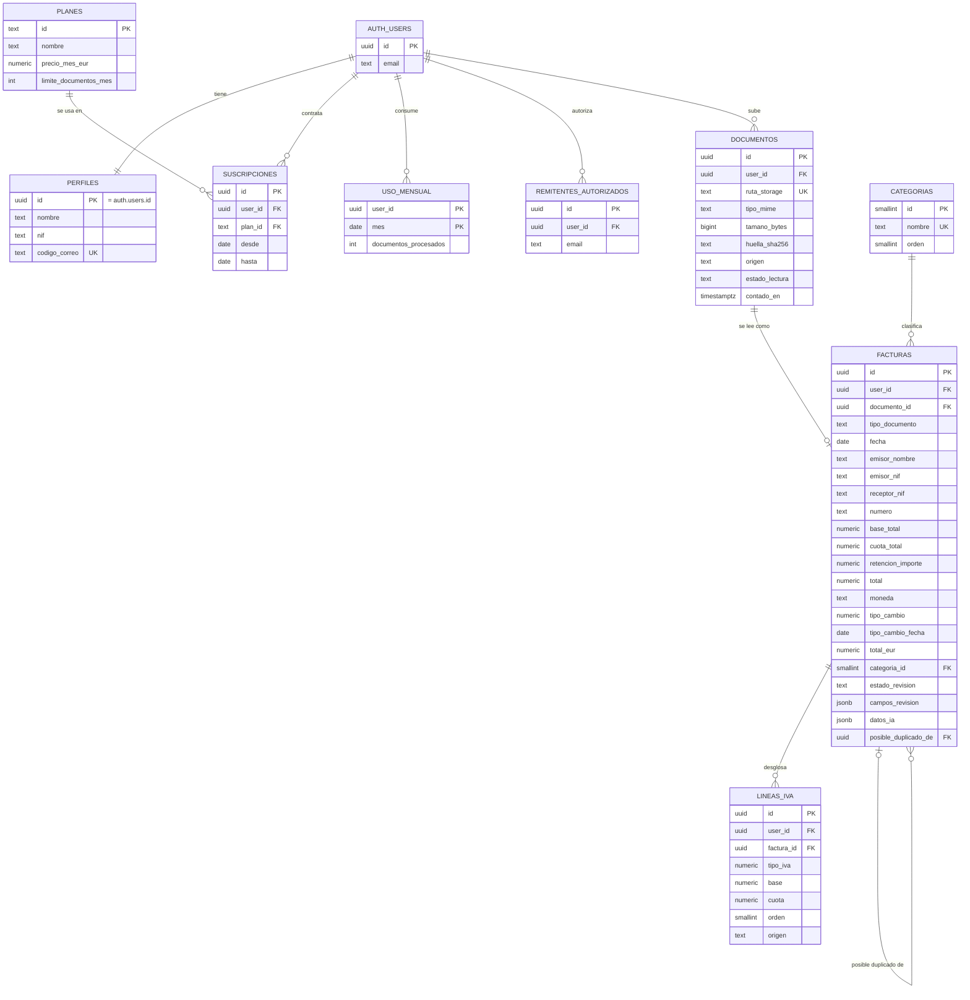

# 07 · Modelo de datos y base de datos

Tarea: #29 (orden 07) · Bloque 2 (subida y lectura) · Responsable: Mireia
Depende de: #5 (stack y arquitectura) · Alimenta: #13, #16, #18, #19, #20, #21, #22, #23 y #31

**Estado:** **[Propuesta]** del 29/10/2026. Las decisiones del apartado 4 las tomó Mireia el 29/10/2026 a partir de las opciones comparadas. Revisado por Javier el 29/10/2026 (cambios pedidos en el PR #44, incorporados el mismo día: apartados 3.6, 3.7, 7 y 8). **No hay nada creado en Supabase**: el SQL de [`modelo-datos.sql`](modelo-datos.sql) es un borrador probado solo en una base de datos PostgreSQL local de pruebas (apartado 7).

Etiquetas (según la [guía de estilo](guia-estilo.md)):

- **[Confirmado]**: comprobado en una fuente o en el repositorio, con enlace y fecha de consulta.
- **[Supuesto]**: lo damos por bueno para avanzar; se indica qué hay que comprobar.
- **[Propuesta]**: decisión o recomendación del equipo; se puede cambiar.
- **[Pendiente]**: falta información o una decisión para poder cerrarlo.

## Glosario

- **Modelo de datos**: el plano de lo que guarda la web y de cómo se relaciona.
- **Tabla**: como una hoja de Excel con columnas fijas. Cada **fila** es una cosa (una factura) y cada **columna** o **campo**, un dato (fecha, total).
- **id**: código único de cada fila. No se repite nunca.
- **Nulo** (`null`): el dato no existe. No es lo mismo que 0.
- **Clave foránea**: columna que guarda el id de una fila de otra tabla. Es la "flecha" que las relaciona.
- **Uno a muchos (1:N)**: una factura tiene muchas líneas de IVA; cada línea es de una sola factura.
- **RLS** (*Row Level Security*): regla dentro de la base de datos para que cada usuario solo vea y cambie sus filas.
- **Política**: cada una de las reglas RLS (una para leer, otra para crear, etc.).
- **JSON**: formato para guardar varios datos en una sola celda, por ejemplo `{"fecha": "alta"}`.
- **Huella SHA-256**: código de 64 caracteres calculado a partir del contenido de un archivo. El mismo archivo da siempre la misma huella.
- **Bucket**: carpeta raíz de archivos en Supabase Storage.

## 1. Resumen

| Tabla | Qué guarda | Quién escribe |
|---|---|---|
| `auth.users` | Usuario y contraseña (la trae Supabase Auth) | Supabase |
| `perfiles` | Nombre, NIF propio y código de la dirección de correo | Usuario (solo nombre y NIF) |
| `planes` | Gratis, Autónomo, Autónomo Plus: precio y límite | Equipo |
| `suscripciones` | Qué plan tiene cada usuario | Servidor |
| `uso_mensual` | Documentos leídos cada mes (límite del plan) | Servidor |
| `remitentes_autorizados` | Correos desde los que el usuario reenvía facturas | Usuario |
| `documentos` | El archivo original: ruta, huella, origen | Usuario (al subir) y servidor |
| `facturas` | Los datos leídos por la IA y corregidos | Servidor (crea) y usuario (corrige) |
| `lineas_iva` | Una fila por tipo de IVA de cada factura | Servidor y usuario |
| `categorias` | Lista común de categorías de gasto | Equipo |

"Servidor" son las rutas de API de Next.js, que usan la clave secreta de Supabase (ver `docs/arquitectura.md`).

## 2. Diagrama



Cómo leerlo: las líneas unen tablas relacionadas. `||` significa "uno exactamente", `o{` "cero o muchos" y `o|` "cero o uno". PK = id de la tabla; FK = clave foránea; UK = valor que no se puede repetir. Solo se muestran los campos principales; la lista completa está en el apartado 3.

## 3. Tablas y campos

Todas las tablas con datos de un usuario llevan `user_id`, que es la columna en la que se basa RLS. Los importes se guardan como **número decimal exacto** (`numeric(12,2)`): un número "de coma flotante" guardaría 0,1 + 0,2 como 0,30000000000000004 y descuadraría céntimos.

### 3.1 `perfiles`

| Campo | Tipo | Obligatorio | Qué significa |
|---|---|---|---|
| id | uuid | Sí | El mismo id que en `auth.users` (uno a uno) |
| nombre | texto | No | Cómo llamar al usuario |
| nif | texto | No | NIF del autónomo. Sirve para avisar si una factura va a nombre de otro |
| codigo_correo | texto, único | Sí | Código aleatorio de 12 caracteres para su dirección de reenvío (#16) |
| creado_en | fecha y hora | Sí | Fecha de alta |

Se crea solo al registrarse (disparador `al_crear_usuario`), junto con una suscripción al plan Gratis.

### 3.2 `planes` y `suscripciones`

`planes`: `id` (`gratis`, `autonomo`, `autonomo_plus`), `nombre`, `precio_mes_eur` (0,00 / 4,99 / 8,99) y `limite_documentos_mes` (10 / 100 / 300). Son las hipótesis de `docs/modelo-negocio.md` (#3), todavía en revisión.

`suscripciones`: `user_id`, `plan_id`, `desde` y `hasta` (vacío mientras está activa). Solo puede haber **una activa** por usuario. Guarda el historial si alguien cambia de plan.

**Por qué el plan no va en `perfiles`:** el usuario puede editar su perfil. Si el plan estuviera ahí, podría cambiarse a Autónomo Plus sin pagar. `suscripciones` es de solo lectura para el usuario.

### 3.3 `uso_mensual`

| Campo | Tipo | Qué significa |
|---|---|---|
| user_id + mes | uuid + fecha | Juntos forman el id. `mes` es el día 1: 2026-10-01 = octubre de 2026 |
| documentos_procesados | entero | Documentos leídos por la IA ese mes |

Solo lo cambia la función `reservar_lectura` (apartado 4, D4).

### 3.4 `remitentes_autorizados`

`user_id` y `email` (en minúsculas). Un correo no puede estar dos veces para el mismo usuario. El *webhook* de correo entrante (#16) solo acepta adjuntos si el remitente está en esta lista.

### 3.5 `documentos` (el archivo original)

| Campo | Tipo | Obligatorio | Qué significa |
|---|---|---|---|
| id, user_id | uuid | Sí | |
| ruta_storage | texto, único | Sí | Ruta en el *bucket* `originales`: `<user_id>/<id>.jpg`. La base de datos comprueba que la primera carpeta sea el propio usuario |
| nombre_archivo | texto | No | Nombre con el que llegó |
| tipo_mime | texto | Sí | `image/jpeg`, `application/pdf`… |
| tamano_bytes | entero | Sí | |
| huella_sha256 | texto (64) | Sí | Huella del archivo para detectar duplicados (#22) |
| origen | lista | Sí | `foto`, `arrastrar`, `correo` o `compartir` |
| correo_message_id | texto | No | Id del correo, si llegó por correo (#16) |
| estado_lectura | lista | Sí | `pendiente`, `leido` o `error` |
| contado_en | fecha y hora | No | Cuándo sumó al contador del plan. Vacío = aún no |
| subido_en | fecha y hora | Sí | |

Se guarda **antes** de leer con la IA: si la lectura falla, el original ya está conservado.

### 3.6 `facturas` (los datos)

| Campo | Tipo | Obligatorio | Qué significa |
|---|---|---|---|
| id, user_id | uuid | Sí | |
| documento_id | uuid, único | Sí | Su archivo original (uno a uno, del mismo usuario) |
| tipo_documento | lista | Sí | `factura` (completa) o `ticket` (factura simplificada) |
| fecha | fecha | No* | Fecha de expedición |
| emisor_nombre | texto | No* | |
| emisor_nif | texto | No | NIF español o VAT extranjero (`IE4276970QH`), sin exigir formato |
| receptor_nif | texto | No | Vacío en los tickets |
| numero | texto | No | **Texto, no número**: hay números con letras, barras o 18 cifras |
| base_total, cuota_total | numérico | No | En la moneda original |
| retencion_tipo, retencion_importe | numérico | No | Retención de IRPF, si la hay |
| total | numérico | No* | En la moneda original |
| moneda | texto (3) | Sí | Código ISO 4217: `EUR`, `USD`. Por defecto `EUR` |
| tipo_cambio | numérico (6 decimales) | No | Unidades de la moneda por 1 € (convención del BCE: 1 € = 1,1133 $). Vacío si es EUR |
| tipo_cambio_fecha | fecha | Si hay tipo | Día del tipo aplicado |
| tipo_cambio_fuente | lista | Si hay tipo | `BCE` o `manual` |
| total_eur | numérico | No* | `total ÷ tipo_cambio` redondeado a 2 decimales, o igual que `total` si es EUR. Vacío mientras falte el tipo de cambio |
| categoria_id | número | No* | Su categoría |
| estado_revision | lista | Sí | `pendiente` o `revisada` (confirmada por el usuario) |
| campos_revision | JSON | Sí | Confianza y corrección por campo (D2) |
| datos_ia | JSON | No | Respuesta original de la IA, sin tocar |
| posible_duplicado_de | uuid | No | Otra factura **del mismo usuario** que se le parece (D1) |
| duplicado_descartado | sí/no | Sí | El usuario indicó "no es duplicado" |
| emisor_nif_norm, numero_norm | texto (calculado) | — | NIF y número sin espacios, guiones ni barras, en mayúsculas, para comparar duplicados |
| creado_en, actualizado_en | fecha y hora | Sí | |

\* Pueden estar vacíos mientras la factura está `pendiente` (por ejemplo, si la IA no los leyó), pero **son obligatorios para marcarla como `revisada`**. La base de datos lo comprueba.

**Normas que comprueba la base de datos:**

- Si la moneda es EUR, no hay tipo de cambio y `total_eur` = `total`.
- Si la moneda **no** es EUR:
  - sin tipo de cambio, la conversión está pendiente y `total_eur` tiene que estar vacío;
  - con tipo de cambio, `total_eur` tiene que ser exactamente `total ÷ tipo_cambio` redondeado a 2 decimales. No se admite un importe en euros "a mano" que no cuadre.
- Si hay tipo de cambio, se guardan su fecha y su fuente.
- Como `revisada` exige `total_eur`, **una factura en otra moneda no se puede marcar como revisada sin convertirla**.
- `posible_duplicado_de` solo puede apuntar a una factura del mismo usuario (clave foránea doble `id` + `user_id`). Si se borra la otra factura, el enlace se vacía. Una factura no puede ser duplicada de sí misma.
- **No** se obliga a que el total cuadre: un céntimo de diferencia en un ticket real impediría guardarlo. Si no cuadra, la pantalla de corrección (#21) avisa. **[Propuesta]**

### 3.7 `lineas_iva`

| Campo | Tipo | Obligatorio | Qué significa |
|---|---|---|---|
| id, user_id | uuid | Sí | |
| factura_id | uuid | Sí | Su factura (del mismo usuario; si se borra la factura, se borran sus líneas) |
| orden | número | Sí | 1, 2, 3… en el orden del ticket. **No se puede repetir** dentro de la misma factura |
| tipo_iva | numérico | Sí | 21, 10, 4, 0… |
| base, cuota | numérico | No | En la moneda de la factura |
| origen | lista | Sí | `impreso` (viene en el ticket) o `calculado` (lo calculamos nosotros) |

**Importes en euros de cada línea:** no se guardan. Se calculan al exportar con el tipo de cambio de la factura (`base ÷ tipo_cambio`), así nunca pueden descuadrar con él. **[Propuesta]** Al redondear cada línea, la suma de las líneas en euros puede diferir en 1 céntimo de `total_eur`; el Excel debe tomar `total_eur` como total.

### 3.8 `categorias`

Lista común: las 10 categorías provisionales de `docs/prueba-ia.md`. **[Propuesta]** Igual para todos los usuarios en el MVP; categorías propias de cada usuario, fuera de alcance.

## 4. Decisiones

Todas tomadas por Mireia el 29/10/2026, entre las opciones comparadas en el borrador del issue.

### D1 · Duplicados (#22): huella + datos, solo aviso **[Propuesta]**

Se avisa (nunca se bloquea) si, entre las facturas **del mismo usuario**:

1. Tienen la **misma huella** (mismo archivo).
2. Tienen el **mismo NIF del emisor, número y total** (misma factura en otro archivo: foto y PDF del correo).
3. Si falta el NIF o el número (tickets como T1 o el peaje E1): **mismo emisor, fecha y total**.

La función `buscar_duplicados` devuelve las coincidencias y el motivo. El usuario puede ver la otra factura y marcar "no es duplicado" (`duplicado_descartado`). La base de datos impide que `posible_duplicado_de` apunte a una factura de otro usuario aunque la ruta de servidor se equivoque.

- Descartado: solo huella (no detecta el mismo ticket fotografiado dos veces) y bloquear (#22 pide avisar; un falso aviso haría perder un ticket).
- **[Supuesto]** La huella se calcula en el navegador antes de subir, para avisar de un archivo repetido sin gastar una lectura. Comprobar en #22 que funciona en móvil.

### D2 · Confianza de la IA por campo: una columna JSON con tres niveles **[Propuesta]**

```json
{
  "fecha":   { "confianza": "alta", "corregido": false },
  "numero":  { "confianza": "baja", "corregido": true },
  "lineas_iva": { "confianza": "media", "corregido": false }
}
```

- `confianza`: `alta`, `media` o `baja`. `corregido`: si el usuario cambió el valor. La pantalla #21 resalta los campos `baja` o vacíos.
- `datos_ia` guarda la respuesta original de la IA, así que siempre se puede saber qué dijo antes de corregir. Esto cumple lo que pide `docs/legal.md` (apartado 6): distinguir valores extraídos de valores confirmados o corregidos.
- **[Confirmado]** en el repositorio: la instrucción actual (`docs/prueba-ia.md`, apartado 10) **no pide confianza**. De dónde sale lo decide #19. **[Propuesta]** Reglas nuestras: campo vacío = `baja`; bases + cuotas ≠ total = `baja` en importes; NIF con formato extraño = `media`. **[Supuesto]** Que un porcentaje que la IA se pone a sí misma no es fiable; no se ha probado.
- Descartado: tabla aparte (unas 13 filas por factura y más programación) y dos columnas por campo (unas 26 columnas más).

### D3 · Tipo de cambio (#20): fecha de la factura o el último publicado antes **[Propuesta]**

- Se usa el tipo de referencia del BCE del **día de la factura**. Si ese día no hay tipo (fin de semana o festivo), el **último publicado antes**. Se guardan el tipo, su fecha y la fuente, y el usuario lo puede corregir (`tipo_cambio_fuente = manual`). Mientras no haya tipo, la factura queda con la conversión pendiente y no se puede marcar como revisada.
- **[Confirmado]** El BCE publica los tipos hacia las 16:00 (hora central europea) cada día hábil, excepto los días de cierre de TARGET, y los publica "solo a efectos informativos". Fuente: BCE, consultado el 29/10/2026.
- **[Supuesto]** Según una fuente secundaria (blog de Invoo, 20/05/2026), el artículo 79.Once de la Ley del IVA establece el tipo de cambio vendedor del Banco de España vigente en el devengo. No se ha podido leer el texto oficial del BOE. **[Pendiente]** Confirmarlo con una gestoría; si fuera otro tipo, solo cambia `tipo_cambio_fuente` y la ruta que lo consulta, no las tablas.
- Descartado: fecha de subida (el importe dependería de cuándo se sube) y fecha de pago (no la tenemos).

### D4 · Límite del plan (#31): contador que solo sube, por mes natural **[Propuesta]**

- Antes de leer un documento con la IA, el servidor llama a `reservar_lectura(documento)`:
  - Si el documento ya se contó, devuelve "sí" sin sumar (**volver a leer no gasta**).
  - Si el usuario ha llegado al límite de su plan este mes, devuelve "no": la web avisa y enlaza a la página de precios.
  - Si no, suma 1 y marca el documento como contado.
- **Borrar un documento no devuelve el hueco**: la lectura ya se ha pagado.
- **Mes natural** (del día 1 al último, hora de Madrid), no "30 días desde el alta".
- Un archivo repetido (misma huella) detectado antes de leerlo no se lee y, por tanto, no cuenta.
- El contador (`uso_mensual`) también sirve para el "documentos usados este mes" de #31.
- Descartado: contar las filas de `documentos` (borrar devolvería hueco) y contar cada lectura (castiga al usuario si la IA falla).

### D5 · Tickets sin NIF del receptor: opcional, con tipo de documento y aviso **[Propuesta]**

- **[Confirmado]** Los 7 tickets de prueba tienen el NIF del receptor vacío. Si fuera obligatorio, no se podría guardar ninguno.
- `receptor_nif` es opcional y `tipo_documento` distingue `ticket` de `factura`. La pantalla y el Excel muestran un aviso "ticket sin tus datos fiscales" (columna `aviso_sin_nif_receptor` de la vista de exportación). Si el usuario tiene su NIF en `perfiles` y el de la factura es otro, también se avisa.
- **[Pendiente]** Qué valor fiscal tiene un ticket sin NIF del receptor lo decide la gestoría. Ticketon solo avisa; no decide qué es deducible (`docs/publico-objetivo.md`, `docs/legal.md`).

### D6 · Retención de IRPF: dos columnas opcionales desde ya **[Propuesta]**

- Algunas facturas que recibe un autónomo (la de su gestoría, un alquiler) llevan retención de IRPF: total = base + IVA − retención. Sin estas columnas, en esas facturas saldría un aviso falso de "no cuadra".
- **[Confirmado]** en el repositorio: la instrucción de la IA no extrae la retención y ningún ticket de prueba la tiene. **[Pendiente]** Añadirla a la instrucción en #19 y probarla con una factura real.

### D7 · Archivo y datos en dos tablas **[Propuesta]**

`documentos` (el archivo) y `facturas` (los datos), uno a uno. Si la IA falla, el original está guardado igual y se puede volver a leer.

## 5. Seguridad por usuario (RLS)

### Cómo funciona

1. Cada fila lleva su dueño en `user_id`.
2. Cuando alguien entra en la web, Supabase sabe quién es: `auth.uid()` devuelve su id. **[Confirmado]** Fuente: documentación de RLS de Supabase, consultada el 29/10/2026.
3. Cada tabla tiene RLS activado y una política por operación con la condición `(select auth.uid()) = user_id`: "solo filas en las que el dueño eres tú". Se escribe con `select` porque así Postgres la calcula una vez por consulta y no una vez por fila. **[Confirmado]** Misma fuente.
4. Además se limitan los **permisos por columna**: el usuario puede corregir los datos de una factura, pero no `datos_ia` ni el contador.

**[Confirmado]** RLS no se activa solo: hay que activarlo en cada tabla. La documentación de Supabase pide comprobarlo en cada tabla nueva y retirar los permisos que se dan por defecto. El SQL lo hace.

### Qué puede hacer cada uno

| Tabla | Usuario con sesión | Sin sesión | Servidor |
|---|---|---|---|
| `planes` | Leer | Leer (página de precios) | Todo |
| `categorias` | Leer | Nada | Todo |
| `perfiles` | Leer el suyo; cambiar solo nombre y NIF | Nada | Todo |
| `suscripciones`, `uso_mensual` | Leer los suyos | Nada | Todo |
| `remitentes_autorizados` | Leer, añadir y borrar los suyos | Nada | Todo |
| `documentos` | Leer, registrar la subida y borrar los suyos | Nada | Todo |
| `facturas` | Leer, corregir y borrar las suyas | Nada | Crear (tras la lectura) y todo |
| `lineas_iva` | Leer, añadir, corregir y borrar las suyas | Nada | Todo |

**Aviso:** el servidor usa la clave secreta, que **se salta RLS**. **[Confirmado]** (misma fuente). Por eso las rutas de API deben comprobar siempre el usuario antes de leer o escribir, y la clave nunca puede estar en el navegador (`.env.example`, PR #39).

### Archivos originales (Storage)

- *Bucket* privado `originales`. Ruta: `<user_id>/<documento_id>.<ext>`.
- Políticas: el usuario puede subir, ver y borrar **solo dentro de su carpeta**, con `(storage.foldername(name))[1] = (select auth.uid())::text`. **[Confirmado]** Fuente: documentación de control de acceso de Supabase Storage, consultada el 29/10/2026.
- **No hay política de modificar**: un original no se puede sobrescribir. Así se protege su integridad (`docs/legal.md`, apartado 4).

### Otras protecciones

- Una línea de IVA solo puede apuntar a una factura **del mismo usuario**, una factura a un documento del mismo usuario y un posible duplicado a otra factura del mismo usuario. Lo comprueba la base de datos con claves foráneas dobles (`id` + `user_id`), además de RLS.
- `ruta_storage` tiene que empezar por el id del propio usuario.
- `buscar_duplicados` y la vista de exportación respetan RLS: solo buscan entre los datos de quien pregunta.

## 6. Cómo se resuelve cada requisito

| Requisito | Dónde se resuelve | Issue |
|---|---|---|
| Usuario, factura, líneas de IVA, archivo original, categoría, plan (#29) | Tablas del apartado 3 | #29 |
| Moneda original, tipo de cambio, importe en EUR (#29) | `facturas.moneda`, `tipo_cambio`, `tipo_cambio_fecha`, `tipo_cambio_fuente`, `total_eur` (comprobado con el tipo); euros de cada línea calculados en la vista de exportación | #29, #20 |
| Confianza de la IA por dato y si se corrigió (#29) | `facturas.campos_revision` + `datos_ia` (D2) | #29, #19, #21 |
| Huella del archivo para duplicados (#29) | `documentos.huella_sha256` | #29, #22 |
| Cada usuario ve solo lo suyo | RLS en todas las tablas y en Storage (apartado 5) | #13 |
| Dirección de correo única y remitentes autorizados | `perfiles.codigo_correo`, `remitentes_autorizados`, `documentos.origen = 'correo'` | #16 |
| Original privado y accesible desde la ficha | `documentos.ruta_storage` + *bucket* privado; enlace temporal firmado | #18 |
| Fecha, emisor, NIF, receptor, número, varios IVA, total, moneda, categoría | Campos de `facturas` y `lineas_iva` (mismos nombres que la instrucción de `prueba-ia.md`) | #19 |
| Marcar campos de baja confianza | `campos_revision` (D2) | #19, #21 |
| Importe original, tipo aplicado e importe en EUR | D3 | #20 |
| Corregir y resaltar dudosos o vacíos | `campos_revision`, `estado_revision`, permisos de corrección | #21 |
| Mismo archivo / misma factura / aviso con opción de ver la otra | D1, `buscar_duplicados`, `posible_duplicado_de` | #22 |
| Periodo, una fila por tipo de IVA, enlace al original | Vista `exportacion_gestoria` (punto de partida, no la exportación final) e índice por fecha. **[Pendiente] bloqueante**: el enlace al original (apartado 8) | #23 |
| Límite por plan, aviso y contador del mes | D4: `planes`, `suscripciones`, `uso_mensual`, `reservar_lectura` | #31 |
| Conservar el original enlazado a sus datos (enunciado) | `documentos` 1:1 `facturas`; sin sobrescritura; sin borrado en cascada desde la cuenta | #18 |

## 7. Comprobación con los tickets reales

**Cómo se hizo (29/10/2026):** se cargó el SQL en un **PostgreSQL 16 local de pruebas**, dentro del entorno de trabajo de Claude, con imitaciones sencillas de `auth.users`, `auth.uid()` y `storage.objects`. **No es Supabase**: confirma que el diseño es coherente, no que funcione igual allí. **[Pendiente]** Repetirlo en el proyecto de Supabase cuando exista (#12).

Los 7 tickets se cargaron a partir de `docs/valores-reales-tickets.xlsx` con un programa, sin teclearlos a mano, y con la huella SHA-256 real de cada archivo de `tests/tickets/`.

| Ticket | Líneas de IVA | Bases + cuotas = total | Qué se comprobó |
|---|---|---|---|
| T1 Alcampo | 4 % y 21 % | 5,36 + 0,43 = 5,79 € | Sin NIF del emisor ni número: se guarda con esos campos vacíos |
| T2 Eroski | 10 %, 21 % y 4 % | 106,51 + 8,69 = 115,20 € | **3 tipos de IVA**; número `132740032509026056` intacto |
| T3 Anthropic | 21 % | 18,00 + 3,78 = 21,78 € | VAT irlandés `IE4276970QH`; tipo `factura` |
| T4 Cervecería | 10 % | 19,09 + 1,91 = 21,00 € | Número `1 / 388087` con barra |
| E1 Peaje AUCALSA | 21 %, **calculado** | 8,43 + 1,77 = 10,20 € | IVA incluido sin desglose: base y cuota marcadas `calculado`; sin número |
| E2 Carrefour | 21 % | 8,26 + 1,73 = 9,99 € | Número alfanumérico |
| E3 Druni | 21 % y 4 % | 24,95 + 3,94 = 28,89 € | 2 tipos de IVA |

Resultado: **53 comprobaciones correctas de 53** (42 iniciales y 11 añadidas tras la revisión de Javier). Además de los tickets:

| Prueba | Resultado |
|---|---|
| El usuario B no ve, cambia ni borra las facturas de A, aunque conozca su id | Correcto |
| B no puede añadir una línea a una factura de A, crear un documento a nombre de A ni guardar un archivo en la carpeta de A | Correcto (se rechaza) |
| B no puede cambiarse de plan, poner a cero su contador, cambiar `datos_ia` ni llamar a `reservar_lectura` | Correcto (se rechaza) |
| Sin sesión no se ven facturas; sí los 3 planes | Correcto |
| T2 subido otra vez: aviso por "mismo archivo" y por "mismo NIF, número y total" (aunque el número llevara espacios) | Correcto |
| T1 fotografiado otra vez (sin NIF ni número): aviso por "mismo emisor, fecha y total" | Correcto |
| B no encuentra duplicados entre las facturas de A | Correcto |
| Marcar como revisada una factura sin categoría | Correcto (se rechaza) |
| Tipo de cambio en una factura en EUR | Correcto (se rechaza) |
| Factura **ficticia** de 20,00 $ con 1 € = 1,1133 $ | Correcto: 17,96 € |
| Factura **ficticia** con retención: 100 + 21 − 15 = 106 € | Correcto |
| Plan Gratis: 10 lecturas sí, la 11.ª no; releer no suma; borrar no devuelve hueco | Correcto |
| Vista de exportación de A: 11 filas (una por línea de IVA) y suma de totales 212,85 € (sin contar dos veces) | Correcto |
| Sobrescribir un original en Storage | Correcto (0 archivos cambiados) |
| Factura en dólares sin tipo de cambio pero con un importe en euros inventado | Correcto (se rechaza) |
| Factura en dólares con un importe en euros que no cuadra con el tipo | Correcto (se rechaza) |
| Factura en dólares pendiente de convertir: se guarda con `total_eur` vacío, pero no se puede marcar como revisada | Correcto |
| Dos líneas de IVA con el mismo orden en una factura | Correcto (se rechaza) |
| Enlazar como duplicado una factura de otro usuario (desde el servidor) | Correcto (se rechaza) |
| Borrar la factura original de un duplicado: el enlace se vacía y el dueño no cambia | Correcto |
| Vista de exportación: línea en dólares pasada a euros con el tipo de la factura (17,96 €) | Correcto |
| Vista de exportación: factura sin líneas sale una vez, con su retención | Correcto |
| Vista de exportación: un solo total por factura | Correcto |

**[Pendiente]** No hay en el banco ningún ticket de gasolinera ni ninguna factura en otra moneda (`tests/tickets/README.md`). El modelo los contempla, pero no se han comprobado con un documento real.

## 8. Qué queda decidido y qué sigue pendiente

### 8.1 Decidido para el MVP (si se aprueba este PR) **[Propuesta]**

- Las tablas, campos y relaciones del apartado 3.
- Las decisiones D1 a D7 del apartado 4.
- Las reglas de seguridad del apartado 5 y las normas de integridad de los apartados 3.6 y 3.7.

Esto es el **diseño**. Que funcione en Supabase **no** queda comprobado con este PR: las pruebas del apartado 7 son locales.

### 8.2 Pendiente, por issue

| # | Qué | Issue y responsable (propuesta) | Bloquea | Cómo se cierra |
|---|---|---|---|---|
| 1 | Ejecutar el SQL en Supabase y repetir las pruebas del apartado 7 con dos cuentas reales, incluidas las políticas de Storage y la vista | #12 y #13 · Javier | El paso a la web (fase 4) | Las pruebas pasan en Supabase |
| 2 | **[Supuesto]** Que el proyecto de Supabase use PostgreSQL 15 o superior (la vista usa `security_invoker` y el duplicado usa `on delete set null (columna)`) | #12 · Javier | El punto 1 | Versión comprobada al crear el proyecto |
| 3 | Añadir a la instrucción de la IA: `tipo_documento`, retención y confianza | #19 · Mireia | — | Prueba con los 7 tickets |
| 4 | Tipo de cambio que exige la norma del IVA (BCE o Banco de España) | #20 · Equipo, con una gestoría | — | Respuesta documentada |
| 5 | **Enlace al original en el Excel**: `ruta_storage` no es un enlace que pueda abrir la gestoría (no tiene cuenta y los enlaces firmados caducan). Opciones: enlace temporal largo, ZIP con los originales o solo el nombre del archivo | #23 · Bloque 3 | **Sí: el cierre de #23** | Decidido en #23 |
| 6 | Columnas definitivas del Excel (la vista `exportacion_gestoria` es un punto de partida, no la exportación final) | #23 · Bloque 3 | El cierre de #23 | Decidido en #23 |
| 7 | Probar con documentos reales un ticket de gasolinera y una factura en otra moneda (hoy no hay ninguno en `tests/tickets/`) | #10 y #31 · Equipo | El cierre de #6 y #31 | Añadidos y probados |
| 8 | Política de baja de cuenta y plazos de conservación. Hasta entonces, nada se borra en cascada al eliminar un usuario | Legal · Javier | — | Decisión documentada en `docs/legal.md` |
| 9 | Borrar un documento: la fila y el archivo de Storage se borran por separado. **[Supuesto]** El archivo se borra con la API de Storage, no con SQL | #18 · Mireia | — | Probado al borrar un documento |
| 10 | Facturas rectificativas o devoluciones con importes negativos: el modelo las admite, pero no hay reglas de aviso | Bloque 3 | — | Fuera del MVP salvo que aparezca un caso |
| 11 | Validar los nombres de las 10 categorías | Equipo | — | Lista aprobada |

Fuera de alcance del MVP: varias empresas o gestorías con acceso a varios clientes, categorías propias de cada usuario, recargo de equivalencia y conexión con bancos.

## 9. Fuentes (consultadas el 29/10/2026)

- Supabase · Row Level Security: https://supabase.com/docs/guides/database/postgres/row-level-security
- Supabase · Control de acceso de Storage: https://supabase.com/docs/guides/storage/security/access-control
- BCE · Tipos de referencia del euro: https://www.ecb.europa.eu/stats/policy_and_exchange_rates/euro_reference_exchange_rates/html/index.en.html
- Fuente secundaria · Invoo, "Facturar en USD o GBP siendo autónomo" (20/05/2026), sobre el artículo 79.Once de la Ley del IVA: https://invoo.es/es/blog/guias/facturar-usd-gbp-autonomo-tipo-cambio-iva/
- BOE · Ley 37/1992 del IVA, texto consolidado (no se pudo leer el artículo 79 con la herramienta): https://www.boe.es/buscar/act.php?id=BOE-A-1992-28740

Documentos internos: `docs/arquitectura.md`, `docs/prueba-ia.md`, `docs/modelo-negocio.md`, `docs/legal.md`, `docs/publico-objetivo.md`, `docs/valores-reales-tickets.xlsx` y `docs/guia-estilo.md`.
